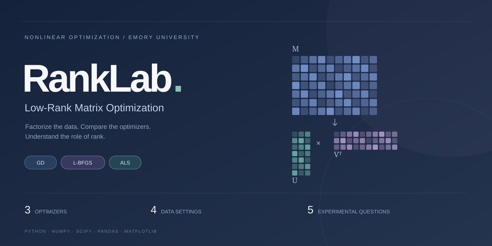
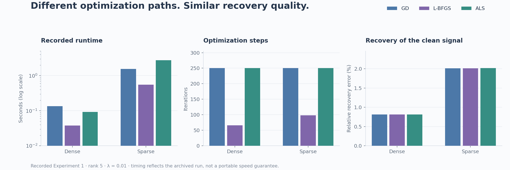
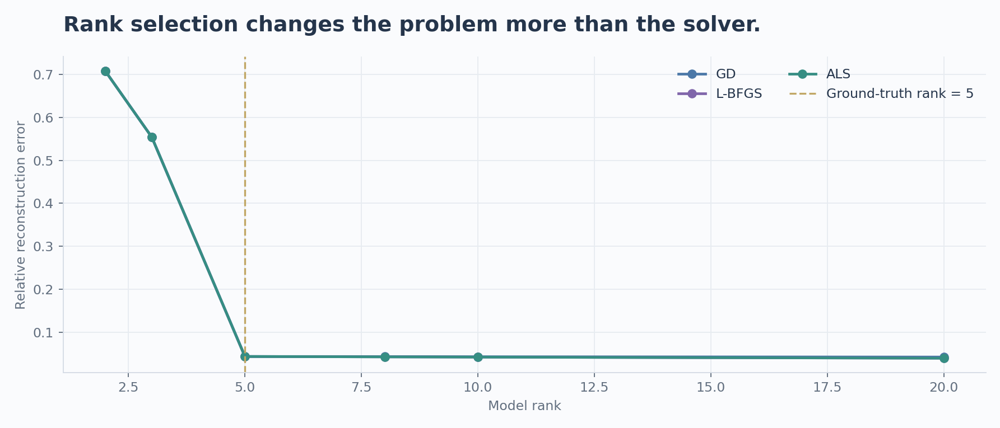
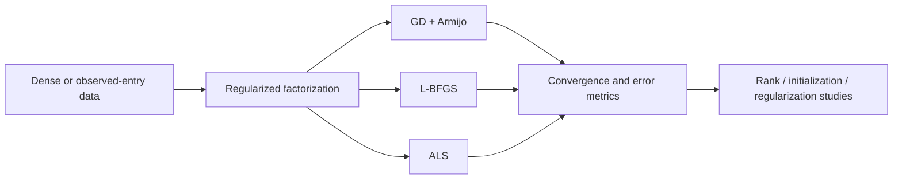

<p align="center">
  
</p>

<div align="center">

**A computational study of regularized matrix factorization: how optimization, initialization, and rank shape the result.**


[The study](#the-study) · [Results](#what-the-recorded-runs-show) · [Quick start](#quick-start) · [Experiments](#five-experimental-questions) · [Code map](#code-map)

</div>

## The study

RankLab compares **Gradient Descent with Armijo backtracking**, **L-BFGS**, and **Alternating Least Squares** on one regularized low-rank factorization problem. The implementation handles both dense matrices and partially observed entries, tracking objective values, gradient norms, iterations, runtime, and reconstruction or prediction error.

The central question is practical: **when the model is fixed, which differences come from the optimizer—and which come from rank, initialization, or regularization?**

| Optimizer | Update strategy | What the comparison reveals |
|---|---|---|
| **GD + Armijo** | Gradient steps with a sufficient-decrease line search | A first-order baseline with explicit step-size control |
| **L-BFGS** | Limited-memory quasi-Newton updates through SciPy | The role of curvature information in convergence |
| **ALS** | Alternating regularized least-squares updates | How block structure changes the optimization path |

### One objective, two observation settings

For dense data:

$$\min_{U,V}\;\frac{1}{2}\lVert UV^\top-M\rVert_F^2+\frac{\lambda}{2}\left(\lVert U\rVert_F^2+\lVert V\rVert_F^2\right).$$

For missing entries, the residual is evaluated only on the observed set $\Omega$:

$$\min_{U,V}\;\frac{1}{2}\sum_{(i,j)\in\Omega}\left(u_i^\top v_j-M_{ij}\right)^2+\frac{\lambda}{2}\left(\lVert U\rVert_F^2+\lVert V\rVert_F^2\right).$$

Here $M\in\mathbb{R}^{m\times n}$, $U\in\mathbb{R}^{m\times r}$, and $V\in\mathbb{R}^{n\times r}$. The factors are jointly nonconvex but each ALS block is a regularized least-squares subproblem. The experiments measure finite-run behavior; they do not establish global optimality.

## What the recorded runs show



**L-BFGS reaches similar clean-signal recovery with fewer iterations in the archived synthetic comparison.** Dense runs have approximately 0.815% relative recovery error across all three methods; sparse runs have approximately 2.01%. That similarity in recovery does not imply identical regularized objectives or stationarity.

| Data setting | Method | Iterations | Recorded time (s) | Relative recovery error |
|---|---|---:|---:|---:|
| Dense | GD | 250 | 0.135 | 0.00815 |
| Dense | L-BFGS | **66** | **0.038** | 0.00815 |
| Dense | ALS | 250 | 0.092 | 0.00815 |
| Sparse | GD | 250 | 1.542 | 0.02012 |
| Sparse | L-BFGS | **98** | **0.551** | 0.02011 |
| Sparse | ALS | 250 | 2.764 | 0.02015 |

<sub>Source: the committed [Experiment 1 summary](results/experiment_1/experiment_1_summary.csv). Both synthetic settings use rank 5 and λ = 0.01. These are archived timings, not portable speed guarantees; 250 iterations is the configured cap, not a convergence claim.</sub>

### Rank is a modeling choice, not just a speed setting



Under-specified rank loses signal that no optimizer can recover within that model. In the recorded dense sweep, moving from rank 2 or 3 to the true rank 5 changes reconstruction quality much more than switching optimizers. The curves use the committed [Experiment 3 results](results/experiment_3/experiment_3_summary.csv).

## Five experimental questions

| Study | Variable | Measurements |
|---|---|---|
| **01 · Method comparison** | GD, L-BFGS, ALS | Objective, gradient norm, runtime, iterations, and dataset-specific error |
| **02 · Initialization** | Small random, large random, and SVD starts | Variation in objective and convergence trajectories |
| **03 · Rank sensitivity** | Factor rank | Reconstruction or held-out prediction error versus model capacity |
| **04 · Regularization** | Ridge penalty λ | Fit–regularization trade-offs |
| **05 · Nonconvex probe** | Interpolation between solutions | Objective values along selected line segments |

The landscape experiment is a diagnostic along sampled paths; it does not enumerate local minima.



## Four supported data settings

| Dataset | Matrix shape | Observation setting | Main evaluation target |
|---|---|---|---|
| **Synthetic dense** | 500 × 200 | Fully observed, known rank-5 signal | Recovery of the clean matrix |
| **Synthetic sparse** | 500 × 200 | Approximately 20% observed | Recovery from incomplete entries |
| **MovieLens 100K** | 943 × 1,682 | Sparse user–item ratings | Train and held-out RMSE |
| **Superconductivity** | 21,263 × 81 | Standardized real-valued features | Relative reconstruction error |

The code supports all four settings. The highlighted method-comparison CSV contains the two synthetic settings; the committed rank-sweep CSV contains synthetic dense and MovieLens runs. Local datasets and newly generated output are excluded from Git.

## Quick start

Use Python **3.10 or newer**. The synthetic example needs no dataset download.

```bash
git clone https://github.com/niccChen/math347.git
cd math347
python3 -m venv .venv
source .venv/bin/activate
python -m pip install numpy scipy pandas matplotlib

python main.py --mode quick
```

The quick run checks selected analytical-gradient coordinates, compares the three optimizers on a 120 × 80 synthetic matrix, and writes figures and a summary CSV.

```text
figures/quick/                     Convergence plots
results/quick/experiment_1_summary.csv
```

### Run the synthetic study

```bash
python main.py --mode full --skip-real \
  --output-dir figures/my-run \
  --results-dir results/my-run \
  --seed 0
```

<details>
<summary><strong>Use the real datasets</strong></summary>

For superconductivity, supply a local CSV. If it is unavailable locally, the loader can try the optional `ucimlrepo` package.

```bash
python main.py --mode full \
  --superconductivity-path /path/to/superconductivity.csv
```

For MovieLens, point to an extracted `ml-100k/` directory or a `u.data` file. The loader supports the standard split files or a seeded split from raw ratings.

```bash
python main.py --mode full --skip-real \
  --include-movielens --movielens-path /path/to/ml-100k
```

To include both real datasets:

```bash
python main.py --mode full \
  --superconductivity-path /path/to/superconductivity.csv \
  --include-movielens --movielens-path /path/to/ml-100k
```

See [`data.py`](data.py) for preprocessing and split behavior. Check terminal messages to confirm which datasets loaded; unavailable real datasets are skipped by the runner.

</details>

<details>
<summary><strong>Rebuild the README visuals from recorded results</strong></summary>

```bash
python docs/build_showcase.py
```

This reads the committed experiment CSVs and regenerates the banner and two showcase figures. It does not rerun optimization or replace the archived measurements.

</details>

## Code map

| File | Responsibility |
|---|---|
| [`data.py`](data.py) | Synthetic generators, dataset loading, preprocessing, and splits |
| [`objectives.py`](objectives.py) | Dense/sparse losses, gradients, packing, and evaluation metrics |
| [`methods.py`](methods.py) | The three optimization methods and history tracking |
| [`experiments.py`](experiments.py) | Method, initialization, rank, regularization, and landscape studies |
| [`plotting.py`](plotting.py) | Experiment figures |
| [`main.py`](main.py) | Quick/full command-line entry point |
| [`results/`](results/) | Committed experiment summaries |
| [`docs/build_showcase.py`](docs/build_showcase.py) | Data-backed README visual generation |

---

**MATH 347 · Non-Linear Optimization · Emory University · Spring 2026**  
Yiyun (Nicole) Chen · Joy Cheng · Sirui Li

<sub>RankLab is the project’s display name; the repository remains at `niccChen/math347`.</sub>
